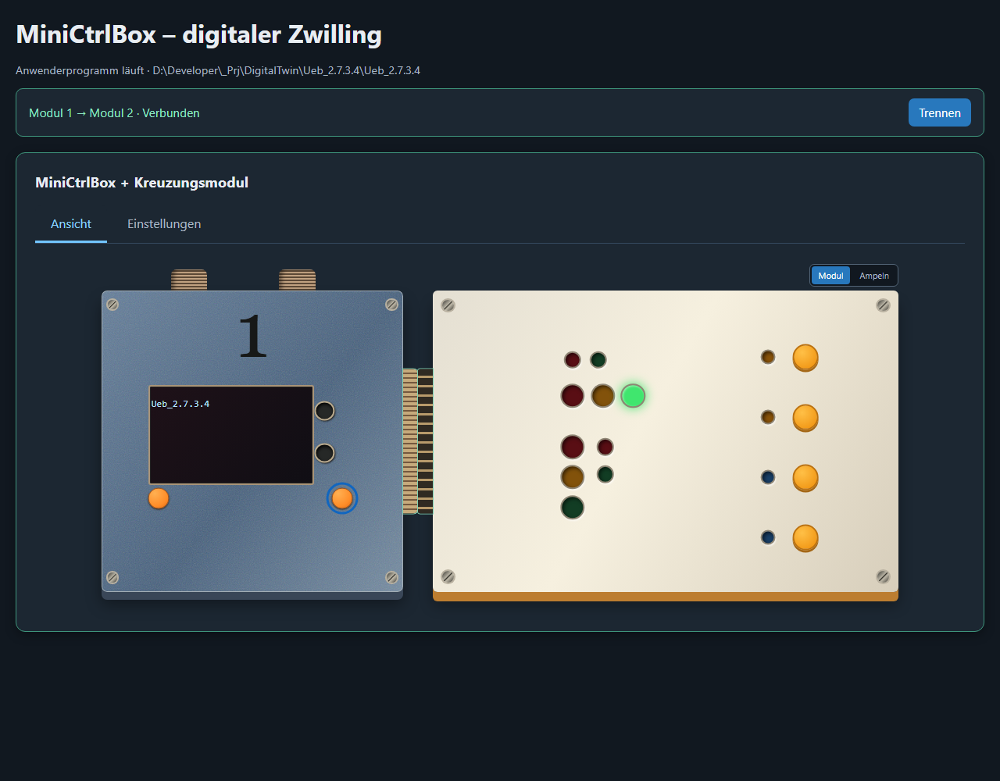
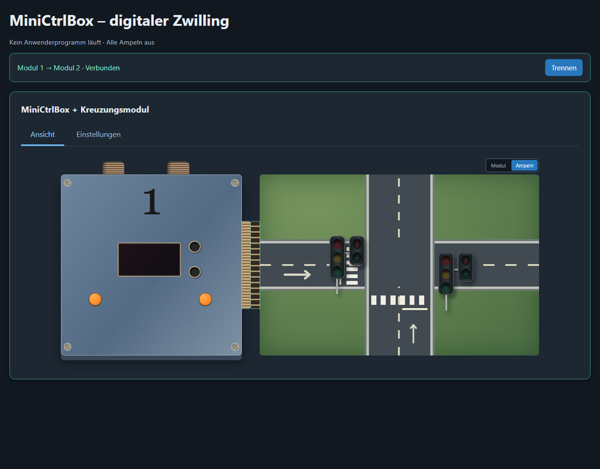
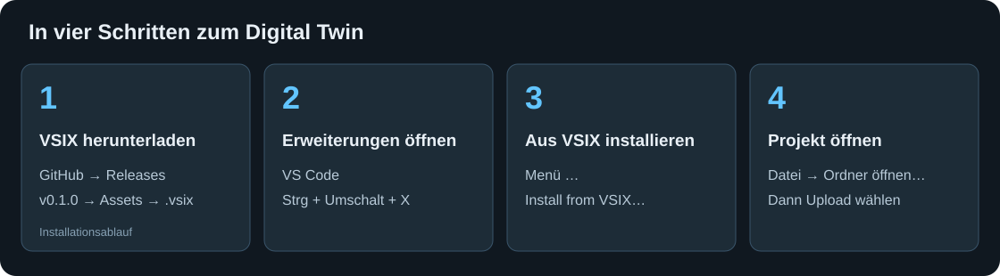

# MiniCtrlBox Digital Twin

> **Mit KI-Unterstützung entwickelt:** Dieses Projekt wurde mit Hilfe von künstlicher Intelligenz (OpenAI Codex) entwickelt und dokumentiert.

MiniCtrlBox-Projekte direkt aus VS Code in einem digitalen Zwilling ausführen: mit OLED, Tastern und gekoppeltem Kreuzungsmodul. Der originale C++-Quellcode steuert die simulierten Ausgänge.

**Zum Lernen:** Im [Begriffslexikon](docs/begriffe/README.md) findest du kurze Erklärungen, Beispiele und Lernaufgaben. Verlinkte Fachbegriffe in den Anleitungen führen direkt zum passenden Eintrag, etwa [Watchdog-Interrupt](docs/begriffe/README.md#watchdog-interrupt).

**[Version v0.1.0 herunterladen](https://github.com/alireza-553/MiniCtrlBoxDigitalTwin/releases/tag/v0.1.0)** · **[VSIX direkt herunterladen](https://github.com/alireza-553/MiniCtrlBoxDigitalTwin/releases/download/v0.1.0/mcb-digital-twin-0.1.0.vsix)**

Das Repository ist privat: Zum Download mit einem GitHub-Konto mit Zugriff anmelden. Die Erweiterung steht unter **Releases → Assets**, nicht unter Packages. „Source code“ ist der Quellcode und nicht die installierbare Erweiterung.

## Vorschau

### MiniCtrlBox und Kreuzungsmodul



Modul 1 und Modul 2 koppeln über ihre seitlichen Steckverbinder zu einer gemeinsamen Ansicht. Einstellungen liegen als Tab direkt im Modul. OLED und Taster gehören zu Modul 1. Das Bild zeigt das laufende Übungsprogramm.

### Ampelansicht



Mit **Modul / Ampeln** oben rechts an Modul 2 zwischen Platine und Straßenansicht wechseln. Je eine Fahrzeug- und Fußgängerampel bilden ein Paar am gemeinsamen Mast. Beide Ansichten zeigen dieselben Programmausgänge. Ohne laufendes Anwenderprogramm bleiben alle Ampeln aus, wie in dieser Vorschau.

## Voraussetzungen

- VS Code ab **1.85**.
- Python 3, erreichbar über `python` oder `python3`. Zusätzliche Python-Pakete sind nicht erforderlich.
- Für C++-Projekte: **Visual Studio C++-Buildtools** unter Windows oder `g++`/`clang++`.
- Ein MiniCtrlBox-Projekt mit `src/main.cpp`, das die vom Desktop-Adapter unterstützten Hardwarefunktionen verwendet.

Eine physische MiniCtrlBox ist nicht erforderlich. Der Python-Simulator ist in der Erweiterung enthalten; das Repository muss zur Benutzung nicht geklont werden.

## Erweiterung installieren



1. Die [Release-Seite v0.1.0](https://github.com/alireza-553/MiniCtrlBoxDigitalTwin/releases/tag/v0.1.0) öffnen und unter **Assets** die Datei **`mcb-digital-twin-0.1.0.vsix`** herunterladen.
2. In VS Code mit **Strg+Umschalt+X** die Erweiterungsansicht öffnen.
3. Oben im Menü **… → Install from VSIX… / Aus VSIX installieren…** auswählen.
4. Die heruntergeladene VSIX-Datei auswählen. Falls VS Code dazu auffordert, das Fenster neu laden.
5. Über **Datei → Ordner öffnen…** deinen MiniCtrlBox-Projektordner öffnen.

Alternativ im Terminal:

```powershell
code --install-extension .\mcb-digital-twin-0.1.0.vsix
```

Unter Windows in den VS-Code-Einstellungen nach **`mcbDigitalTwin.pythonPath`** suchen und bei Bedarf `python` oder den [vollständigen Pfad](docs/begriffe/README.md#pfad) zur `python.exe` eintragen. Mit `python --version` im Terminal die Installation prüfen.

Falls bereits eine interne Entwicklungsversion `0.4.x` installiert ist, diese zuerst deinstallieren und anschließend `0.1.0` installieren. Mit `0.1.0` beginnt die neue Release-Reihe; frühere Nummern waren Entwicklungsstände.

## Projekt hochladen und benutzen

1. Den C++-Projektordner in VS Code öffnen. Bei mehreren Workspace-Ordnern eine Datei des gewünschten Projekts aktivieren.
2. Links das **MiniCtrlBox-Symbol** öffnen und **Digital Twin → Projekt laden und starten** wählen. Alternativ das **Upload-Symbol unten neben „MCB Digital Twin“** oder oben in der Steuerungsansicht anklicken.
3. Die Erweiterung speichert geänderte Dateien dieses Projekts, startet den Simulator, baut den C++-Code und startet das Anwenderprogramm. Die Oberfläche öffnet sich in VS Code.
4. In der Oberfläche **Verbinden** wählen, um das Kreuzungsmodul an die MiniCtrlBox zu koppeln. Modul 2 benötigt diese Verbindung.
5. Über **Modul / Ampeln** die Darstellung von Modul 2 wechseln. Lichtzustände kommen ausschließlich aus deinem Programm.
6. Das **OLED anklicken** oder mit Enter öffnen, um den Inhalt groß zu lesen. Mit **Schließen** oder Escape zurückkehren.
7. Unter **Einstellungen → Modul 1** den Projektpfad ansehen und das **Programm starten / stoppen**. **Digital Twin → Digital Twin beenden** in der Erweiterung beendet den von ihr gestarteten Simulator.

Die orangefarbenen Taster sind Programmeingänge. Ihre Wirkung hängt vom C++-Programm ab. Es gibt keine manuelle Ampel-Phasensteuerung.

### Beispiel: Ueb_2.7.3.4

Mit dem geprüften Übungsprogramm startet die erste Fahrzeugampel rot. Der linke Taster an Modul 1 schaltet sie aus/ein, der rechte wechselt die Phase. Die zweite Fahrzeugampel und beide Fußgängerampeln bleiben dunkel, solange das Programm sie nicht ansteuert.

## C++ mit Haltepunkten debuggen (ab Version 0.2.0)

Das [VSIX der Version 0.2.1](https://github.com/alireza-553/MiniCtrlBoxDigitalTwin/releases/download/v0.2.1/mcb-digital-twin-0.2.1.vsix) enthält die Debug-Anbindung und die Korrektur für lange `delay()`-Aufrufe. Der erste Release v0.1.0 enthält sie noch nicht. Das neue Paket über **Aus VSIX installieren…** installieren und das VS-Code-Fenster neu laden. Einen bereits laufenden alten Twin zuerst stoppen.

Voraussetzung ist zusätzlich die Microsoft-Erweiterung **C/C++** (`ms-vscode.cpptools`). Unter Windows wird bei einem [Build](docs/begriffe/README.md#build) mit MSVC der Visual-Studio-Debugger verwendet. Bei einem Build mit `g++`/`clang++` muss [GDB](docs/begriffe/README.md#gdb-openocd) im PATH liegen; die Erweiterung verbindet sich dann über GDB.

Das Betriebssystem muss das Anfügen an den Prozess erlauben. Insbesondere Linux kann GDB-Attach über seine `ptrace`-Richtlinie einschränken; die Erweiterung verändert diese Sicherheitseinstellungen nicht.

1. Deinen C++-Projektordner öffnen und eine Quelldatei auswählen.
2. Mit einem Klick links neben die Zeilennummer oder **F9** einen Haltepunkt in `setup()`, `loop()` oder einer aufgerufenen Funktion setzen.
3. In der MiniCtrlBox-Seitenleiste **Digital Twin → Projekt debuggen** wählen. Das Debug-Symbol steht auch oben in der Steuerungsansicht und unten neben dem Upload-Symbol.
4. Der Twin baut das Projekt mit Debug-Symbolen und ohne Optimierung. Der Debugger verbindet sich, bevor `setup()` ausgeführt wird. Eine eigene `launch.json` ist nicht erforderlich.
5. Am Haltepunkt unter **Ausführen und Debuggen** Variablen, Überwachung und Aufrufliste ansehen. **F10** führt den nächsten Schritt aus, **F11** springt in eine Funktion und **F5** setzt das Programm fort.
6. Mit **Umschalt+F5** die Debugsitzung beenden. Der zugehörige C++-Prozess wird gestoppt und der temporäre Build entfernt.

Am Haltepunkt bleibt die Oberfläche bedienbar und zeigt den zuletzt vollständig übertragenen Zustand. Neue Ausgangswerte erscheinen während `delay()` sowie nach Abschluss von `setup()` oder des jeweiligen `loop()`-Durchlaufs. Einzelschritte aktualisieren daher nicht nach jeder C++-Zeile die Ampeln. Während einer Pause oder Wartezeit werden die aktuellen Taster-/Schalterzustände für den nächsten Durchlauf übernommen; kurze Klicks, die vollständig in der Pause liegen, können nicht als Ereignis ankommen.

Im Debugmodus gibt es keine Zwei-Sekunden-Grenze für Antworten des C++-Programms. Ein blockierendes Programm muss über **Debuggen beenden** oder **Programm stoppen** beendet werden. Der Desktop-Adapter und seine unterstützten Hardwarefunktionen bleiben die Grundlage; dies debuggt keine Firmware auf einer echten ESP32-Platine.

## Echte MiniCtrlBox über USB debuggen (ab 0.3.0)

Die [Erweiterung 0.3.9](vscode-extension/mcb-digital-twin-0.3.9.vsix) ordnet die Seitenleiste in **Digital Twin**, **Echte Hardware** und **Werkzeuge**. Unter **Echte Hardware** stehen **Programm übertragen** und **Hardware debuggen**. Die [Treibereinrichtung](docs/begriffe/README.md#treiber) liegt unter **Werkzeuge**. Die Browseransicht bleibt der [Simulator](docs/begriffe/README.md#simulator); eine Live-Spiegelung der echten Hardware ist nicht enthalten.

Voraussetzungen: [PlatformIO IDE](docs/begriffe/README.md#platformio), ein Arduino-Projekt mit `board = esp32-c3-devkitm-1`, genau eine MiniCtrlBox am [nativen USB-Anschluss](docs/begriffe/README.md#usb-jtag) und ein funktionierender USB-JTAG-Treiber. Unterstützt wird ESP32-C3 ab Revision 0.3. Ein USB-UART-Wandler reicht für USB-JTAG nicht aus; GPIO18/19 dürfen nicht anderweitig belegt sein. [Espressifs Anleitung](https://docs.espressif.com/projects/esp-idf/en/latest/esp32c3/api-guides/jtag-debugging/configure-builtin-jtag.html).

1. Den PlatformIO-Projektordner öffnen und die MiniCtrlBox über USB anschließen. Den seriellen Monitor schließen.
2. **Echte Hardware → Programm übertragen** baut das Projekt und überträgt es auf den erkannten USB-COM-Port. Die bisherige Firmware wird ersetzt.
3. Zum Debuggen Haltepunkte setzen und **Echte Hardware → Hardware debuggen** wählen. Auch dieser Befehl überträgt Firmware auf die MiniCtrlBox und startet sie neu.
4. Die Erweiterung ergänzt in `platformio.ini` eine eigene Umgebung `mcb-usb-debug-<Projektumgebung>`. Die bestehende Umgebung und ihre Einstellungen bleiben erhalten. Abweichende vorhandene Debug-Umgebungen werden nicht überschrieben.
5. PlatformIO baut den Debug-Build, verbindet sich über USB-JTAG und hält in `setup()`. F10/F11/F5 und die Variablenansicht funktionieren in der VS-Code-Debugansicht.
6. Mit Umschalt+F5 die Hardware-Debugsitzung beenden. Das Verhalten des Controllers nach dem Trennen bestimmt PlatformIO/OpenOCD; bei Bedarf die MiniCtrlBox zurücksetzen.

Die ergänzte Umgebung erbt die Projektkonfiguration:

Ab **0.3.11** verwendet **Hardware debuggen** einen [Debug-Build](docs/begriffe/README.md#debug-release) mit **`-O0`** (großes O, Ziffer Null) und `-g3 -ggdb3`. Die [Compileroptionen](docs/begriffe/README.md#compileroptionen) schalten die meisten Optimierungen ab und liefern Debug-Informationen. Dadurch lassen sich Einzelschritte besser dem Quellcode zuordnen. Im geprüften `OFF`-Zweig von `setPhase()` führte F10 danach von Zeile **87 → 89 → Aufrufer**, statt irreführend Zeile 67 anzuzeigen. Die normale Uploadumgebung bleibt unverändert; nach einer Änderung ist ein neuer Hardware-Debugstart einschließlich Build und Übertragung nötig.

Die [Optimierungsstufen `-O0`, `-Og`, `-O1` bis `-O3`, `-Os` und `-Ofast`](docs/begriffe/README.md#optimierung) erklärt das Begriffslexikon. Ablauf und geprüfte Grenzen stehen in der [Hardware-Anleitung](docs/HARDWARE_DEBUG.md#zeilenanzeige-bei-switch-und-break).

```ini
[env:mcb-usb-debug-esp32-c3-devkitm-1]
extends = env:esp32-c3-devkitm-1
build_type = debug
debug_build_flags = -O0 -g3 -ggdb3
debug_tool = esp-builtin
upload_protocol = esp-builtin
debug_init_break = thbreak setup
```

Bei mehreren passenden Umgebungen fragt die Erweiterung nach der gewünschten. Bei mehreren angeschlossenen Espressif-USB-Geräten bitte die übrigen trennen, damit kein anderes Board programmiert wird. Ein anderer PlatformIO-Core ist über `mcbDigitalTwin.platformioPath` wählbar.

### Treibereinrichtung für andere PCs

Der digitale Zwilling braucht keinen USB-Treiber. Zum Debuggen der echten Hardware benötigt jeder PC dagegen einen funktionierenden USB-JTAG-Zugriff.

Unter **Windows** prüft die Erweiterung vor dem Hardware-Debugging die JTAG-Schnittstelle. Ist sie bereits korrekt eingerichtet, passiert nichts weiter. Andernfalls lädt die Automatik das feste Espressif-Treiberpaket von `dl.espressif.com`, prüft SHA-256 und die Espressif-Signatur und startet das Windows-Treiberwerkzeug. Die **Windows-Administratorabfrage muss der Nutzer selbst mit „Ja“ bestätigen**. Der Ablauf lässt sich auch mit **USB-JTAG-Treiber einrichten** starten. Internet ist nur nötig, wenn das Paket noch nicht im Cache liegt.

Die Automatik ist über `mcbDigitalTwin.autoInstallJtagDriver` abschaltbar. Abbruch, fehlende Rechte oder fehlgeschlagene Prüfung stoppen den Hardware-Debugstart mit einer Fehlermeldung. Bei nötigem Neustart die MiniCtrlBox neu verbinden bzw. Windows selbst neu starten und erneut versuchen.

Unter **Linux** müssen USB-Zugriffsregeln eingerichtet sein; unter **macOS** wird normalerweise kein separater USB-JTAG-Treiber benötigt. Die Windows-Treiberinstallation wird dort nicht ausgeführt. [Offizielle Treiberanleitung](https://docs.espressif.com/projects/esp-idf/en/latest/esp32c3/api-guides/jtag-debugging/configure-builtin-jtag.html#configure-usb-drivers).

Bei `LIBUSB_ERROR_NOT_FOUND` kann OpenOCD die JTAG-Schnittstelle nicht öffnen. Ein sichtbarer COM-Port allein bestätigt keinen funktionierenden Debugzugriff. Auf dem geprüften PC war der generische Microsoft-WinUSB-Treiber zugeordnet. Nach Installation und Zuordnung des signierten Espressif-Pakets erkannte OpenOCD den RISC-V-Kern des ESP32-C3 erfolgreich. Ein Firmware-Upload war für diesen Verbindungstest nicht nötig.

Die technische Umsetzung und der Ablauf sind in [Hardware-Debugging und Treiberautomatik](docs/HARDWARE_DEBUG.md) beschrieben.

## Bedienung und Einstellungen

Die [Bedienungsanleitung](docs/BEDIENUNG.md) beschreibt alle Schaltflächen, Voraussetzungen und das Verhalten beim Hardware-Debugging. Das [Begriffslexikon](docs/begriffe/README.md) erklärt die Fachwörter dazu.

| VS-Code-Einstellung | Standard | Zweck |
| --- | --- | --- |
| `mcbDigitalTwin.pythonPath` | `python3` | Python-Befehl oder vollständiger Interpreterpfad. |
| `mcbDigitalTwin.openInsideVSCode` | `true` | Oberfläche innerhalb von VS Code öffnen. |
| `mcbDigitalTwin.platformioPath` | leer | PlatformIO-Programmdatei; automatisch aus dem PlatformIO-Core bzw. PATH ermitteln. |
| `mcbDigitalTwin.autoInstallJtagDriver` | `true` | Fehlenden Windows-JTAG-Treiber vor dem Hardware-Debugstart automatisch einrichten; Windows fragt nach Administratorrechten. |

Optional im Anwenderprojekt eine `mcb-digital-twin.json` anlegen, etwa für einen anderen Port:

```json
{
  "port": 8765,
  "autoOpen": true
}
```

Für die normale Nutzung ist diese Datei nicht erforderlich.

## Wenn etwas nicht funktioniert

| Problem | Lösung |
| --- | --- |
| Python wird nicht gefunden | `mcbDigitalTwin.pythonPath` auf den funktionierenden Python-Befehl oder Interpreterpfad setzen. |
| C++-Compiler fehlt | Visual Studio C++-Buildtools oder `g++`/`clang++` installieren. Details unter **Ausgabe → MiniCtrlBox Digital Twin** prüfen. |
| Kein Anwenderprojekt gefunden | Ordner mit `src/main.cpp` öffnen. Ein äußerer Ordner mit genau einem solchen Unterprojekt wird ebenfalls erkannt. |
| Ampeln bleiben dunkel | Programmstatus prüfen und Modul 2 verbinden. Nur programmierte Ausgänge leuchten. |
| Oberfläche öffnet sich nicht | Bei Standardport `http://127.0.0.1:8765` im Browser öffnen; Ausgabe auf Startfehler prüfen. |

Der Desktop-Adapter führt `setup()` und `loop()` als Prozess auf deinem Rechner aus. Er emuliert kein ESP32-Firmwareabbild. Unterstützt sind GPIO, OLED, Taster sowie ab 0.3.10 die unten beschriebenen EEPROM- und CAN-Funktionen. Andere Hardwarebibliotheken können Buildfehler verursachen.

### EEPROM und CAN im C++-Programm (ab 0.3.10)

Die Entwicklungsversion 0.3.10 lässt sich mit `python vscode-extension/build_vsix.py` bauen. Anschließend `vscode-extension/mcb-digital-twin-0.3.10.vsix` in VS Code über **Aus VSIX installieren** installieren und das Fenster neu laden.

Der Twin lädt seinen projektbezogenen EEPROM bereits beim Start. **EEPROM speichern** funktioniert auch ohne laufendes C++-Programm; nach dem vollständigen Beenden und erneuten Öffnen ist der gespeicherte Projektname sofort wieder sichtbar. Das mit `--project-root` ausgewählte Projekt bestimmt den Speicher.

`#include <EEPROM.h>` unterstützt `begin(size)` (1–4096 Bytes), `read`, `write`, `get`, `put`, `length`, `commit` und `end`. Erst `commit()` oder `end()` speichert Änderungen über Programm- und Twin-Neustarts hinweg. Der Speicher ist pro aufgelöstem Projektpfad getrennt und liegt unter `%LOCALAPPDATA%/MiniCtrlBoxDigitalTwin/eeprom` (Windows) bzw. `$XDG_DATA_HOME/MiniCtrlBoxDigitalTwin/eeprom` oder `~/.local/share/MiniCtrlBoxDigitalTwin/eeprom` (Linux/macOS). Temporäre C++-Builds können gelöscht werden, ohne den EEPROM zu verlieren.

Der Desktop-Teil von `CEeprom` in `MiniCtrlBox.h` bietet `isPresent`, `getAddress`, `getFreeSpace`, `readProjectName`, `writeProjectName`, `readUserData(buffer, length)` und `writeUserData(buffer, length)`. Der Projektname ist mit dem Eingabefeld der Oberfläche verbunden. Benutzerbytes teilen denselben Speicher wie `EEPROM`; CEeprom-Schreibaufrufe speichern sofort. Die Oberfläche zeigt die Bytes 0–15 in Hexadezimaldarstellung.

`#include <driver/twai.h>` unterstützt `twai_driver_install`, `twai_start`, `twai_stop`, `twai_driver_uninstall`, `twai_transmit` und `twai_receive` mit `twai_message_t`, Standard-/Extended-Identifiern und bis zu acht Datenbytes. Die unterstützte Konfiguration ist `TWAI_TIMING_CONFIG_500KBITS()` mit `TWAI_FILTER_CONFIG_ACCEPT_ALL()` und `TWAI_MODE_NORMAL` oder `TWAI_MODE_NO_ACK`. Andere Filter/Bitraten werden ausdrücklich abgewiesen. `CCanBus` bietet außerdem `Frame` (`canIdentifier`, `dlc`, `data[8]`), `start`, `stop`, `restart`, `transmit` und `receive` als einfache Desktop-Schnittstelle.

Bei laufendem C++-Programm sendet das CAN-Feld an dessen Eingang; **CAN empfangen** zeigt ausschließlich dessen gesendete Antwort. Die CAN-ID kann beispielsweise als `0x101` eingegeben werden. Ohne Anwenderprogramm bleibt der bisherige Python-CAN-Test verfügbar. Das ursprüngliche Ampelprogramm bleibt unverändert und verwendet EEPROM/CAN deshalb erst, wenn es selbst entsprechende Aufrufe enthält.

Dies ist eine Verhaltenssimulation: keine elektrischen Signale, Arbitration, Bus-Off-Simulation oder registergenaue ESP32-Emulation. Senden und Empfangen sind nicht blockierend; Timeout-Parameter werden nur zur Quellcodekompatibilität angenommen. Während `delay()` oder eines Debug-Halts eintreffende CAN-Frames werden bis zum nächsten `loop()`-Durchlauf gepuffert. Ein- und Ausgangspuffer halten jeweils bis zu 256 Frames. Weitere MiniCtrlBoxLib-/ESP-IDF-Aufrufe werden nicht automatisch unterstützt.

## Entwicklung

Ab **0.3.12** führt **Werkzeuge → Unit-Tests ausführen** die Tests von Erweiterung und Simulator lokal auf deinem PC aus. Ergebnisse und übersprungene Tests stehen in der Ausgabe. Der GitHub-Workflow ist deaktiviert; dafür entstehen keine GitHub-Actions-Rechenkosten. [Umfang und Voraussetzungen](docs/TESTS.md).

| Ordner | Inhalt |
| --- | --- |
| `mcb_digital_twin/` | Zentraler Python-Simulator und Tests. |
| `vscode-extension/` | Erweiterung einschließlich mitgeliefertem Simulator. |
| `docs/images/` | Vorschaubilder und Installationsgrafik. |

Simulator ohne Erweiterung starten:

```bash
python mcb_digital_twin/web_app.py
```

Danach `http://127.0.0.1:8765` öffnen.

Prüfen und das Paket bauen:

```bash
node --check vscode-extension/extension.js
node vscode-extension/test/upload.test.js
python -m unittest discover -s mcb_digital_twin -p "test_*.py"
python vscode-extension/build_vsix.py
```

Ergebnis: `vscode-extension/mcb-digital-twin-0.3.9.vsix`. Versionshistorie: [CHANGELOG.md](CHANGELOG.md).
